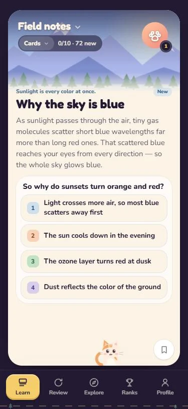
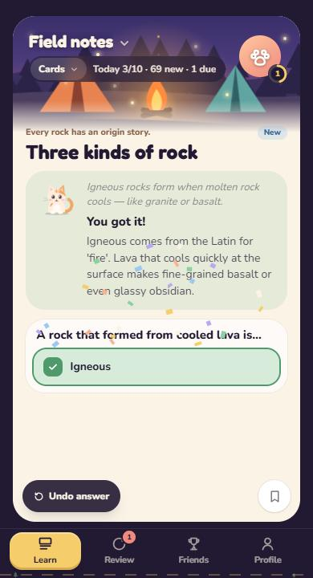
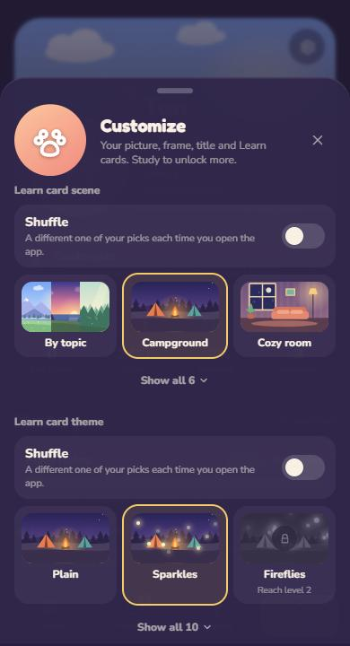

# Trailcards

**Study anything by scrolling: one card, one idea, one swipe at a time.**

React · TypeScript · Vite · Tailwind · Framer Motion · Supabase · PWA

<p>
  
  &nbsp;
  
  &nbsp;
  
</p>

## Why I built it

Flashcard apps work, but opening one feels like homework. Scrolling a feed doesn't. I wanted studying to take the same zero effort to start: open the app, read one short card, answer it, swipe, and before you notice you've done ten.

So Trailcards is a feed, not a deck list. Every card teaches one idea in a few sentences, asks one question, and explains the answer right there. Cards you learn come back on a spaced schedule, and a small cast of things (a streak, levels, unlockable scenes, a cat named Mochi) gives you a reason to come back tomorrow.

## In 30 seconds

1. Pick a name and a picture, then pick what to study: make a deck with AI, paste flashcards, or try the built-in nature deck.
2. Read a card, answer it, see why. Swipe up for the next one.
3. Cards you've learned come back in **Review** a day later, then 3 days, a week, and longer.
4. Ten answers a day keeps your streak. XP fills your level and unlocks new card scenes and looks.

## Features

- **A feed you swipe.** One card per swipe, no scrolling inside a card. Multiple choice and open "recall" cards, with the explanation in place after you answer.
- **Make a deck with AI, without an API key.** Type a topic or paste your notes; "Open ChatGPT" or "Open Claude" opens the chat with the prompt already filled in. Copy the reply, come back, and it lands in the import box. Quizlet, Anki and Knowt exports paste in too.
- **Spaced review.** Right answers move a card from New to Familiar to Mastered on growing intervals; misses come back sooner.
- **Make it yours.** Five Learn card scenes (campground, cozy room, beach, city night, snowy cabin) and nine card themes (sparkles, rain, leaves, aurora…), with a Shuffle that picks a different favourite each time you open the app. Plus picture frames, backgrounds and title effects.
- **Friends.** Sign in with an email code and an invite code to join a group: a weekly and all-time leaderboard, and decks your friends shared that you can add in one tap.
- **Works offline, installs like an app.** Everything is saved on the device first; add it to your home screen and it runs full screen.

## For engineers: what's under the hood

| Area | How it works |
| --- | --- |
| **Local-first state** | One `GameState` saved to `localStorage` and rebuilt through `sanitize.ts` on every load, so old or hand-edited saves can't crash the app. Sync pushes a few seconds after changes; on sign-in the copy with more XP wins, so a new phone catches up and an old one never overwrites newer progress. |
| **Server rules** | Supabase with row-level security on every table. XP only reaches the leaderboard through `add_xp`, which caps each call and each day on the server. Groups are invite-only (`join_group`); decks and pictures are readable by group members only. |
| **Pager** | A hand-rolled one-card-per-swipe pager instead of CSS scroll snap: the card follows your finger, a flick or a 60px drag moves exactly one card, and it settles in about 0.2s, so you can tap an answer right away. Trackpads get one card per gesture. |
| **Scenes and effects** | Every scene is hand-drawn SVG in code, in a shared 400×300 space; the art is placed in the middle strip that a card's header actually shows. Themes are CSS particles over the scene, drawn only on the card in view. |
| **Sound** | Synthesized with Web Audio: mallet chimes that climb with your streak, a paper-flick swipe. No audio files. |
| **Feedback that doesn't spam** | Answering raises achievements, level-ups and streak toasts once. Undo takes back that answer's XP and trophies and removes any toast that hasn't shown yet; re-answering can't replay one you've already seen. |

## What I learned

- **Clipping is per layer.** A rounded card with `overflow: hidden` clips each child separately, and their anti-aliased edges add up into a faint light line along the corners. `clip-path` clips the group once.
- **Some features don't exist on the web.** iPhone home-screen web apps get no vibration at all. I built haptics, tested every workaround, and removed the setting instead of shipping a switch that does nothing.
- **Undo is a state problem, not a button.** Taking an answer back has to unwind XP, streaks, trophies and the celebrations they triggered, or people find the spam loop in a minute.
- **Testing like a new user finds the real problems.** Fresh-account runs found a landing page that didn't fit small phones, a tour nobody needed, and two tabs that were the same empty sign-in screen.
- **Next:** generating decks inside the app for signed-in users, with a daily limit, so making a deck is one tap.

## Tech stack

- **App:** React 18, TypeScript, Vite 6, Tailwind CSS 4, Framer Motion
- **Backend:** Supabase (Postgres with row-level security, email-code auth, storage)
- **Audio:** Web Audio API, synthesized
- **Tests:** Vitest for the game rules, deck parsing and save loading

## Run it locally

```bash
npm install
npm run dev
```

Without a Supabase project the app runs fully on the device; the Friends tab just says it isn't connected. To turn on accounts and the leaderboard, create a project, run the SQL in `supabase/migrations/`, and add a `.env.local`:

```bash
VITE_SUPABASE_URL=https://your-project.supabase.co
VITE_SUPABASE_KEY=your-publishable-key
```

```bash
npm test
npm run build
```

## Project structure

```
src/
  App.tsx            tabs, onboarding, the app frame
  screens/           Learn and Review feed, Friends, Profile
  components/        sheets, deck import, Mochi, toasts, nav
  state/             game rules (XP, review schedule, unlocks), save and sanitize, store
  data/              built-in cards, achievements, looks, deck parsing and the AI prompt
  art/               SVG scenes and Mochi
  fx/                sound and confetti
  net/               Supabase client and account sync
supabase/migrations/ tables, row-level security and server functions
```

---

## About

Built by Tan Thai. [LinkedIn](https://linkedin.com/in/tanthai028) · [GitHub](https://github.com/tanthai028)

More projects: [Stride](https://github.com/tanthai028/stride-desktop-app) · [YTBookmarks](https://github.com/tanthai028/YTBookmark) · [yt-transcriber](https://github.com/tanthai028/yt-transcriber) · [RJ Job Tracker](https://github.com/tanthai028/RJTracker)
